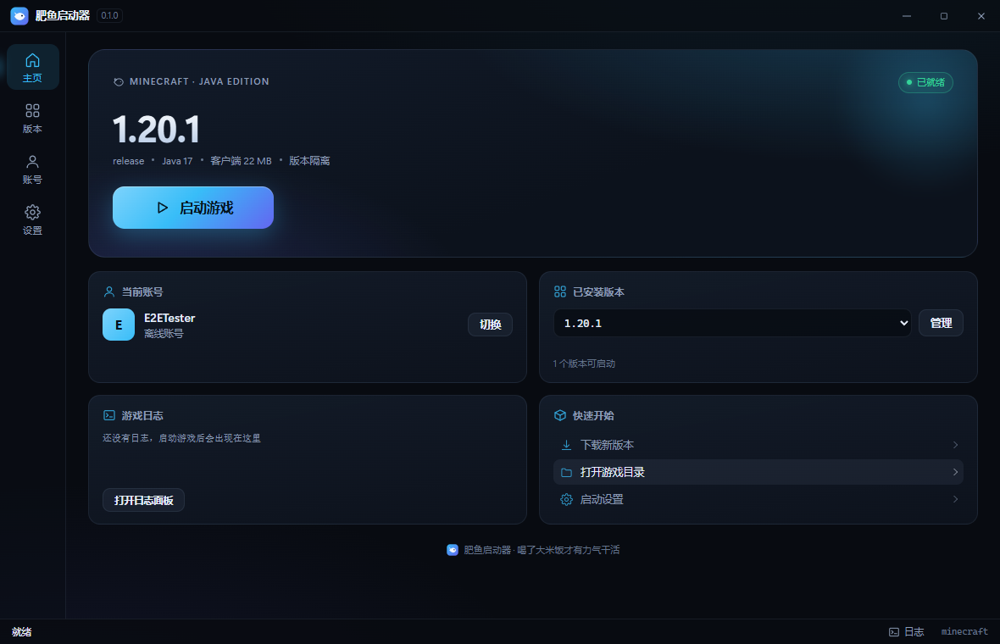

# 肥鱼启动器 · Feiyu Launcher

从零写起的 Minecraft: Java Edition 启动器。Electron + React + TypeScript。版本解析、资源下载、参数拼装、登录、模组加载器安装全部自己实现。

**项目位置：`D:\feiyu-launcher`**



## 实测状态

| 功能 | 状态 | 证据 |
| --- | --- | --- |
| 界面 | ✅ | 六个页面 + 日志抽屉 + 状态栏 |
| 版本清单 / 安装 | ✅ | 1.20.1 704 MB / 1.8.9 138 MB，资源 0 缺失 |
| 启动原版 | ✅ | 1.20.1 与 1.8.9 都进了主菜单 |
| **最新版 26.3（Java 25）** | ✅ | 589 MB / 5149 个资源文件 / 8 分钟装完；Java 25.0.1 自动选对，日志 `LWJGL 3.4.3+4`、`Sound engine started` |
| Java 探测 | ✅ | mojang / 系统两路，严格匹配版本 |
| Java 自动下载 | ✅ | Java 8（143.2 MB）/ 17（86.9 MB）/ 25（100.2 MB，242.8 秒）都实测下载并成功启动 |
| **Fabric 安装** | ✅ | 0.14.23 / 0.15.11 / 0.20.1 三个版本都装成，日志 `Loading 149 mods` |
| **Quilt 安装** | ✅ | 0.24.0 装成并进主菜单：日志 `Loading Minecraft 1.20.1 with Quilt Loader 0.24.0`、`Backend library: LWJGL 3.3.1`、`Sound engine started` |
| **Forge 安装** | ✅ | 47.4.29，窗口标题 `Minecraft* Forge 1.20.1` |
| **NeoForge 安装** | ✅ | 1.20.1-47.1.105，`Launching target 'forgeclient'` + 进主菜单 |
| **OptiFine 安装** | ✅ | HD_U_I5，日志 `Loading tweak class name optifine.OptiFineTweaker` |
| **整合包（.mrpack）** | ✅ | Fabulously Optimized：51 个文件 + 27 个 overrides，进游戏 `Loading 149 mods`；资源页「整合包」tab 直接点安装 |
| **模组下载（Modrinth）** | ✅ | 搜到 112 个结果，Sodium 949 KB 落到 `mods/`，游戏里被 Fabric 加载 |
| **资源包 / 光影 / 数据包** | ✅ | Faithful 32x 10.8 MB → `resourcepacks/`；BSL v10.1.8 1.1 MB → `shaderpacks/`；VeinMiner 数据包 166 KB → `datapacks/`（原版只认存档里的 datapacks，界面上有提示） |
| **实例导出 / 导入** | ✅ | 导出 69 个文件 → zip；导入解成 `xxx-imported`（不覆盖同 id），json 内 id 同步改名，导入的副本实测能启动 |
| **实例组件移除** | ✅ | Fabric API 移除后挪进 `_removed\<时间>\`，mods 里只剩 sodium；UI 刷新后组件列表少一项；挪回去即恢复 |
| **实例重命名** | ✅ | 把导入的实例改成中文名「改名测试实例」：目录、版本 json（含 id 字段）一起改，模组/存档/配置都在，改名后实测能启动 |
| **自定义版本目录** | ✅ | 设置里可把 versions 单独指到任意文件夹；实测装 1.20.1 落到 `myversions`，classpath 指向新目录、`--gameDir` 走版本隔离、进主菜单 60 秒无崩溃 |
| **服务器列表（servers.dat）** | ✅ | 自写 NBT 读写：增删改后文件结构经 hexdump 校验，游戏启动读该文件无报错；UI 实测添加后变 3 条 |
| 离线账号 / 多账号 | ✅ | 离线 UUID 与正版算法一致 |
| **外置登录（第三方验证服）** | ✅ | LittleSkin：服务器元数据读取、登录错误处理、authlib-injector 下载、`-javaagent` 参数构造全部实测；真账号进游戏待你有账号时验 |
| 微软登录 | 🟡 | Live Connect 设备码已打通（拿到 user_code），真账号登录未验证 |
| 打包 | ✅ | `dist\FeiyuLauncher-Setup-0.1.0.exe`（98 MB NSIS） |

## 32 位（x86）支持

同一份源码能出 32 位包：

| 架构 | 命令 | 产物 |
|---|---|---|
| 64 位 | `node scripts/build.mjs` + `electron-builder --win` | `FeiyuLauncher-Setup-<版本>.exe`、`FeiyuLauncher-<版本>-portable.exe` |
| 32 位 | `pnpm dist:ia32` | 同名的 `-ia32` 后缀包 |

32 位包里额外做了这些事：

- Electron 用 `win32-ia32` 那份（Electron 43 及以前还发；44 起官方不再提供 32 位）
- Java 运行时取 Mojang 清单里的 `windows-x86`，装在 `runtime/<组件>-x86/`，不和 64 位那套抢目录
- 内存：自动模式固定 1024 MB，手动最多 2048 MB（32 位 JVM 只有 4 GB 地址空间）
- natives 按位数挑：`natives-windows`（64 位）/ `natives-windows-x86`（32 位）/ `natives-windows-arm64`，不再三份全下
- 陶瓦联机只有 64 位构建，32 位包会直接提示不支持

## Linux 支持

Linux 上能做的是**带 Electron 的绿色包**和 AppImage / deb，代码里已经按 Linux 处理好：

- 数据目录：`~/.local/share/feiyu-launcher`（XDG 规范）。Windows 那套「数据跟着 exe 走」在 AppImage 里不成立——exe 在只读挂载点，所以非 Windows 一律走系统目录
- Java 运行时取 Mojang 清单里的 `linux` / `linux-i386`，下载完给 `bin/java` 补 `0o755` 执行位（manifest 里 `executable` 标记的文件都补）
- 陶瓦联机解出来的可执行文件同样补执行位
- 路径分隔符、natives 分类器（`natives-linux` / `-x86` / `-arm64`）都按平台走
- 打包目标：AppImage、deb、tar.gz

在 Linux 上打包：

```bash
pnpm dist:linux
```

在 Windows 上只能出 `dir` + `tar.gz`（AppImage / deb 依赖 Linux 侧的 appimagetool、dpkg 等工具，没有 Docker 就别指望）：

```bash
node scripts/fetch-electron.mjs --platform=linux --arch=x64
node scripts/build.mjs
node node_modules/electron-builder/out/cli/cli.js --linux dir tar.gz
```

在 Windows 上打出来的 tar.gz 里所有文件都是 0644，Linux 解压后 `./feiyu-launcher` 跑不起来，补一下权限位：

```bash
python scripts/fix-linux-tar.py dist/feiyu-launcher-<版本>.tar.gz
```

（会重写成 `-linux-x64.tar.gz`，`feiyu-launcher` / `chrome_crashpad_handler` 给 0755，`chrome-sandbox` 给 4755。在 Linux 上原生打包不需要这一步。）

常见坑：Ubuntu 23.10+ 默认关闭了非特权 user namespace，AppImage 会启动失败，需要 `--no-sandbox` 或 `sudo sysctl kernel.apparmor_restrict_unprivileged_userns=0`。

## 怎么跑

```bash
cd D:\feiyu-launcher
pnpm install --ignore-scripts --config.node-linker=hoisted
pnpm setup:electron
pnpm dev            # 构建 + 启动
pnpm dist           # 打安装包
```

### 为什么不用 electron-vite

这台环境里 esbuild 的原生子进程起不来（`spawn EPERM`），vite / electron-vite 都依赖它。改成 **rollup + @rollup/plugin-typescript** 纯 JS 构建链（`scripts/build.mjs`）。

### 命令行冒烟测试

```bash
pnpm cli:build
set FEIYU_DATA_DIR=D:\feiyu-launcher\.testdata

node scripts/cli.cjs list
node scripts/cli.cjs java
node scripts/cli.cjs install 1.20.1
node scripts/cli.cjs launch 1.20.1 --name Steve

node scripts/cli.cjs loader-list fabric 1.20.1
node scripts/cli.cjs loader-list forge 1.20.1
node scripts/cli.cjs loader-install fabric 1.20.1 0.15.11
node scripts/cli.cjs loader-install forge 1.20.1 47.4.29

node scripts/cli.cjs res search sodium
node scripts/cli.cjs res search faithful resourcepack
node scripts/cli.cjs res download sodium 1.20.1 fabric fabric-loader-0.15.11-1.20.1
node scripts/cli.cjs res download faithful-32x 1.20.1 - fabric-loader-0.20.1-1.20.1 resourcepack

node scripts/cli.cjs servers list fabric-loader-0.20.1-1.20.1
node scripts/cli.cjs servers add fabric-loader-0.20.1-1.20.1 鱼塘 mc.fish.fun

node scripts/cli.cjs inst components fabric-loader-0.20.1-1.20.1
node scripts/cli.cjs inst export fabric-loader-0.20.1-1.20.1
node scripts/cli.cjs inst import "D:\feiyu-launcher\.testdata\minecraft\exports\xxx.zip"
```

> `res download` 里 `-` 表示「这个位置留空」（PowerShell 传空字符串会被吃掉）。
> 版本目录可以用 `FEIYU_VERSIONS_DIR` 单独指定，跟 `FEIYU_DATA_DIR` 一样只影响 CLI 测试。

## 模组加载器是怎么实现的

### Fabric / Quilt：纯 JSON 拼装

这两个加载器提供「profile JSON」接口：

```
GET https://meta.fabricmc.net/v2/versions/loader/{mc}/{loader}/profile/json
GET https://meta.quiltmc.org/v3/versions/loader/{mc}/{loader}/profile/json
```

返回的就是一份标准的版本 JSON（`inheritsFrom` 指回原版），带 `mainClass: net.fabricmc.loader.impl.launch.knot.KnotClient` 和 8~11 个库。只要把它存成 `versions/<id>/<id>.json`，剩下的交给通用安装流程去下库就行——不需要跑任何安装器。

难点在库的坐标格式：Fabric 的库只有 Maven 坐标 + `url` 字段，没有 `downloads.artifact`。所以 `resolveLibraries` 里加了一条「从 `group:artifact:version:classifier` 拼路径」的兜底。

### Forge / NeoForge：跑官方 installer

这俩没法只靠 JSON。原因：安装过程要执行 10 个 processor（`installertools`、`jarsplitter` 等 Java 程序）来生成 patched client jar，纯 JS 复刻不现实。

所以做法是：

1. 从 BMCLAPI 拿版本列表（`/forge/minecraft/{mc}`、`/neoforge/list/{mc}`）
2. 下载对应 installer（`/forge/download?mcversion=..&version=..&category=installer&format=jar`）
3. **先补一个 `launcher_profiles.json`**（installer 会检查「有没有官方启动器装过」，没有就直接报错退出）
4. **把 installer 要的库全部用 BMCLAPI 的 `/maven/` 预下载到 `libraries/`**——这是能跑通的关键。要预下载三批：
   - `install_profile.json` 里的 `libraries`（带 sha1/size）
   - `install_profile.json` 里 `processors[].jar` 和 `processors[].classpath` 的 maven 坐标（没 sha1，存在即跳过）
   - **installer 内嵌的 `version.json` 里的 `libraries`**（fancymodloader 的 core/events/language-* 全在这，漏了就会卡在 `maven.neoforged.net` 超时）
5. 用 Java 17 跑 `java -jar installer --installClient <游戏目录>`
6. installer 跑完在 `versions/` 下留了 json，但我们还得补两样东西：
   - 写自己的 `.installed.json`（installer 不认这个）
   - **把 `libraries/net/neoforged|minecraftforge/forge/<mc>-<ver>/forge-<mc>-<ver>-client.jar` 复制成 `versions/<id>/<id>.jar`**（installer 只把它留在 libraries 里，官方启动器要求 versions 下有个同名 jar，Forge 的 `-DignoreList` 里就是按这个名字认的）
7. 找版本目录时注意命名：NeoForge 1.20.1 的 installer 沿用了 Forge 的命名 `1.20.1-forge-47.1.105`（mc 前缀 + forge + 去掉 mc 前缀的版本号），照 `neoforge-*` 去找会扑空

### OptiFine：解包 + 手工拼版本

OptiFine 的 installer 是会弹 GUI 的自解压 jar（1.20.1 这版连 `install_profile.json` 都没有，只有 `optifine/*.class` 和一堆 `.xdelta` 补丁）。所以没法静默跑，只能手工拼：

1. installer 本体其实就是 optifine jar，复制到 `libraries/optifine/OptiFine/<ver>/`
2. 从包里取 `launchwrapper-of-*.jar` 一起放进 libraries
3. 拼一份 `inheritsFrom` 的版本 json：`mainClass = net.minecraft.launchwrapper.Launch`，`--tweakClass optifine.OptiFineTweaker`

启动验证：`Loading tweak class name optifine.OptiFineTweaker` → `[OptiFine] OptiFine ZIP file: ...`。

### 整合包：.mrpack 就是 zip

`.mrpack` 里有一个 `modrinth.index.json`：

```json
{
  "dependencies": { "minecraft": "1.20.1", "fabric-loader": "0.14.23" },
  "files": [{ "path": "mods/xxx.jar", "downloads": ["https://..."], "hashes": { "sha1": "..." } }]
}
```

安装流程：读 dependencies → 装原版 + 对应加载器 → 按 files 下载到版本目录 → 解压 `overrides/` 覆盖配置。路径都做了 `..` 过滤防目录穿越。

## 外置登录是怎么实现的

第三方皮肤站（LittleSkin、Blessing Skin 这类）走的是 **Yggdrasil API**，Minecraft 本身不认，得靠 `authlib-injector` 在启动时把认证端点换掉。

流程：

1. `GET {api}` 读服务器元数据（`serverName`、`implementationName`），用来在界面上显示服务器名、顺便验证地址对不对
2. `POST {api}/authserver/authenticate` 发 `{username, password, clientToken, agent}`，拿 `accessToken` + `selectedProfile`
3. 本地只存 `accessToken` / `clientToken` / 服务器地址，**密码不落盘**
4. 启动时加 `-javaagent:<authlib-injector.jar>={api}`，游戏就只跟这个服务器验证了
5. 令牌过期用 `POST {api}/authserver/refresh` 续期（和微软账号一样在启动前自动做）

`authlib-injector` 从 BMCLAPI 镜像下载（`/mirrors/authlib-injector/artifact/latest.json`），下过就缓存在 `libraries/authlib-injector/`。

实测：

```
服务器元数据: {"serverName":"LittleSkin","implementationName":"Yggdrasil Connect"}
错误账号登录:  用户名或密码错误。Incorrect username or password.
injector:     authlib-injector-1.2.8.jar (341 KB)
启动参数:      -javaagent:...\authlib-injector-1.2.8.jar=https://littleskin.cn/api/yggdrasil
```


用 Modrinth 的公开 API（不需要 API key）：

- 搜索：`GET /v2/search`，`facets` 里塞 `project_type` / `versions` / `categories`
- 版本：`GET /v2/project/{id}/version?game_versions=[...]&loaders=[...]`
- 下载：取 version 里的 `files[0].url`，按资源类型落到 `mods/` `resourcepacks/` `shaderpacks/` `datapacks/` `modpacks/`

整合包是 `.mrpack`（zip + `modrinth.index.json`），已经实现了读取 index 的函数，安装器还没接。

## 下载页（仿 PCL 布局）

左侧二级分类，右侧内容：

```
社区资源：模组 / 整合包 / 数据包 / 资源包 / 光影包 / 世界 / 收藏夹
安装包：  Minecraft / OptiFine / Forge / NeoForge / Cleanroom / Fabric / Legacy Fabric / LabyMod / LiteLoader
```

- **社区资源** 来自 Modrinth，卡片可以点 ♥ 收藏
- **世界** 扫本地 `versions/<id>/saves`，能打开目录、删存档
- **收藏夹** 存在 `launcher-store.json` 的 `favorites` 字段里
- **Minecraft** 是原版版本列表（带虚拟滚动的）
- **Cleanroom / LabyMod / LiteLoader** 目前只给了说明（它们的安装器要么没接、要么是专有程序）

## 数据放哪

默认 `%APPDATA%\feiyu-launcher\minecraft`：

```
minecraft/
├── versions/<id>/        版本 json、client jar、natives、.installed.json
├── libraries/            Maven 目录结构的依赖库
├── assets/               indexes / objects / log_configs / virtual/legacy
├── runtime/              启动器下载的 Java
├── installers/           Forge/OptiFine 安装器（装完可删）
├── launcher_profiles.json  给 Forge installer 看的假文件
└── logs/                 每次启动的完整日志
```

## 代码结构

```
src/
├── main/
│   ├── index.ts          窗口 + IPC + 启动诊断日志
│   ├── cli.ts            命令行冒烟测试
│   └── core/
│       ├── paths.ts      目录约定
│       ├── http.ts       下载器（并发池 / 重试 / 双源回退 / 429 退避 / sha1 / 进度）
│       ├── manifest.ts   版本清单、版本 JSON、继承链合并、镜像改写
│       ├── install.ts    库与资源解析、规则判断、natives 解压、安装编排
│       ├── java.ts       Java 探测（严格匹配）+ Mojang JRE 下载
│       ├── auth.ts       离线 UUID + 微软设备码（Live Connect / Azure 双端点）
│       ├── launch.ts     命令行构造 + 进程管理 + 日志流
│       ├── loaders.ts    Fabric/Quilt/Forge/NeoForge/OptiFine 安装
│       ├── modrinth.ts   社区资源搜索与下载
│       └── store.ts      设置与账号持久化
├── preload/              contextBridge，只暴露 window.api
├── renderer/             React UI（主页/版本/安装包/资源/账号/设置）
└── shared/               两边共享的类型
```

## 踩过的坑（都是真踩的）

- **继承链合并方向反了**：`getResolvedVersionJson` 原本从「最具体的子版本」开始、再被父版本覆盖，结果 Fabric/Forge 的 `mainClass` 全被原版 `net.minecraft.client.main.Main` 盖掉。表现是「游戏能启动、但完全没有模组」——Forge 日志里那句 `Completely ignored arguments: [--launchTarget, forgeclient...]` 就是铁证。修成「父版本打底、子版本逐层覆盖」之后，Fabric 立刻打出 `Loading 10 mods`。
- **Forge 的 patched jar 不在 versions 目录**：installer 只把 `forge-*-client.jar` 放进 `libraries/`，不复制到 `versions/<id>/`。少了这份，ModLauncher 会在 `ModuleLayerHandler.buildLayer` 里报 `failTwoSuppliers` 崩掉。
- **Forge installer 要求先有 `launcher_profiles.json`**：否则直接 `There is no Minecraft launcher profile` 退出。
- **natives 有两种形态**：1.19+ 是名字带 `natives-windows` 的独立库；1.8.9 用 `natives` 映射 + `classifiers`，后者如果只下 `artifact`（22 字节的空 jar），DLL 一个都解不出来 → `UnsatisfiedLinkError: no lwjgl64`。
- **去重键要带 classifier**：`lwjgl` 和 `lwjgl:natives-windows` 是同一个 group:artifact。
- **老版本不能用高版本 Java 凑数**：1.8.9 在 Java 17 上必崩。
- **spawn 的 pipe 在受限环境会 EPERM**：Java 探测和游戏进程都改成「重定向到文件 + 增量读取」。
- **`ELECTRON_RUN_AS_NODE=1`** 会让 Electron 退化成纯 node，打包后的 exe 一跑就退。
- **浏览器里没有 `process`**：打包 React 要替换 `process.env.NODE_ENV`。
- **镜像会 429/503**：下载器后半程自动换源；Java 运行时下载把并发降到 4 才不被 BMCLAPI 限流。

## 版权

MIT。Minecraft 是 Mojang 的商标，这项目跟 Mojang 没关系。Forge 的作者请求不要自动化下载安装，这里实现了但请优先支持官方渠道。
